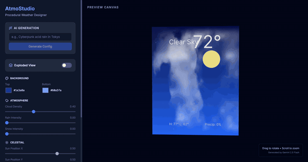
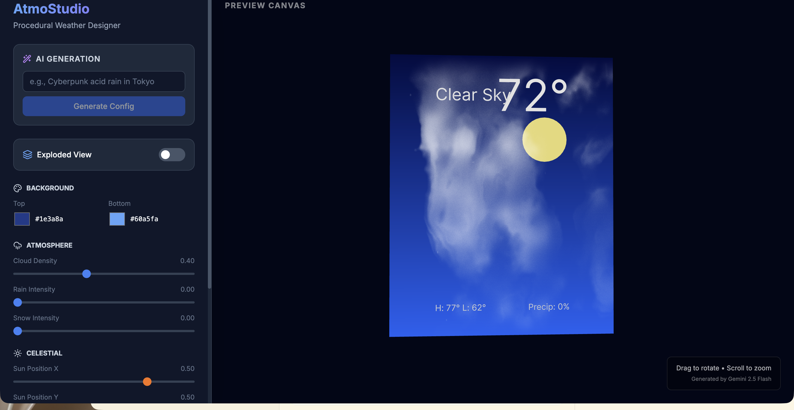
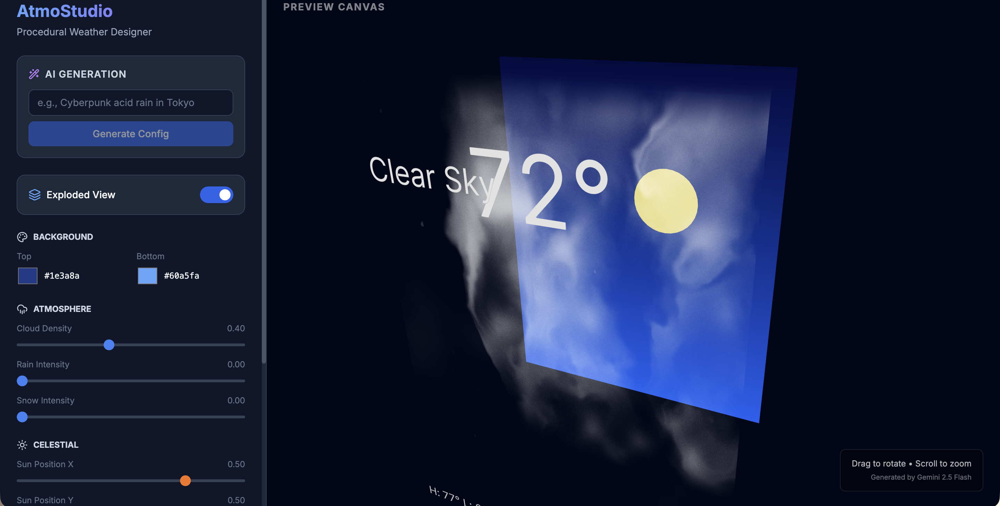
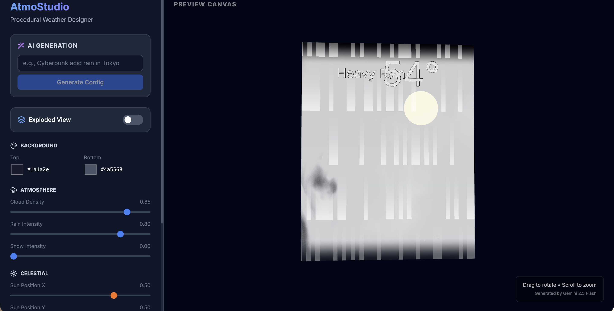

# AtmoStudio



A 3D weather card designer powered by GLSL shaders and Gemini AI. Build weather scenes layer by layer — gradient skies, procedural clouds, rain, snow, dust particles — then let Gemini generate configs from natural language prompts like "cyberpunk acid rain in Tokyo."



## Quick Start

```bash
git clone https://github.com/yourusername/atmostudio.git
cd atmostudio
npm install
npm run dev
```

Requires Node.js 18+. The app runs at `http://localhost:3000`.

### AI Generation (optional)

To enable the "Generate Config" feature, create a `.env.local` file with a [Gemini API key](https://aistudio.google.com/apikey):

```
VITE_GEMINI_API_KEY=your_key_here
```

The card designer works fully without AI — all parameters are manually adjustable.

## How It Works

Drag the sliders, pick colors, type a weather description. Every change updates a 3D weather card rendered in real-time on a WebGL canvas.

The card is built from five composited layers, each a separate shader plane:

1. **Background** — vertical gradient (two colors)
2. **Sun/Moon** — movable circle with color and scale
3. **Clouds** — FBM noise shader with density, speed, and opacity
4. **Precipitation** — rain streaks, snowflakes, mist/fog, dust particles (all wind-affected)
5. **Text** — condition label, temperature, hi/lo, precipitation %

Toggle **Exploded View** to separate the layers in 3D space and inspect how they stack.



Type a weather description into the AI prompt and hit **Generate Config** — Gemini returns structured JSON that maps directly to every slider and color picker, instantly transforming the scene.



## Tech Stack

| Layer | Technology |
|-------|-----------|
| Framework | React 19 |
| 3D | Three.js, React Three Fiber, drei |
| Shaders | Custom GLSL (FBM noise, precipitation compositing) |
| AI | Gemini 2.5 Flash via `@google/genai` (structured output) |
| Styling | Tailwind CSS 3 |
| Build | Vite 6 |
| Icons | Lucide React |

## License

[MIT](LICENSE)
